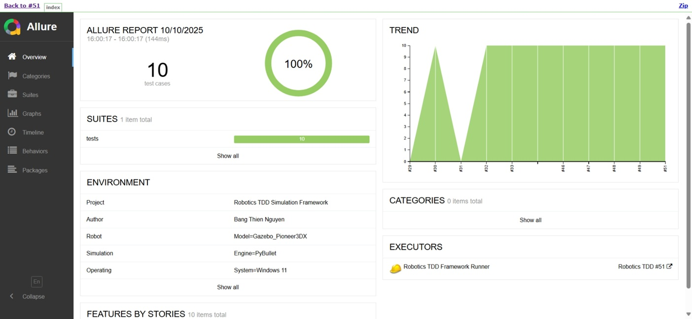

# 🤖 Robotics Test-Driven Development (TDD) Framework

> **A robust, test-driven framework for verifying functionality, path planning, and safety protocols of a simulated mobile manipulator robot.**

---


---

## 👤 Author & Contact

**Author:** Bang Thien Nguyen  
**Email:** [ontario1998@gmail.com](mailto:ontario1998@gmail.com)

---

## 🛠️ Core Technologies

| Component | Technology | Role |
|------------|-------------|------|
| **Test Runner** | `pytest` | Test discovery and execution engine |
| **Test Logic** | Python Modules (`test_*.py`) | Unit, integration, and E2E TDD tests |
| **Reporting** | `Allure`, `pytest-html` | Interactive and static dashboards |
| **Isolation** | `Docker` | Ensures reproducible, consistent environments |

---

## 💡 Project Overview

This framework embodies **Test-Driven Development (TDD)** — writing tests *before* implementation — to ensure reliable, modular, and maintainable robotic simulation logic with full test traceability.

---

<details>
<summary>🚀 <b>Quick Start (Click to Expand)</b></summary>

### ✅ Prerequisites
- 🐳 **Docker Desktop** – Required for containerized testing  
- 💻 **Windows Command Prompt** – To execute `run_docker.bat`  
- 🐍 *(Optional)* **Python 3.10+** – For local runs  
- 📊 *(Optional)* **Allure CLI** – For interactive reports  

---

### ⚙️ Installation

```bash
git clone git clone https://github.com/luckyjoy/robotics_tdd.git
cd robotics_tdd
pip install -r requirements.txt  # Optional for local testing
```

---

### 🧪 Run Tests with Docker (Recommended)

```bash
run_docker.bat
```

This performs:
1. Docker validation & cleanup  
2. Image build → `robotics-tdd-local:latest`  
3. Test execution  
4. Automatic Allure Report launch at [http://localhost:8080](http://localhost:8080)

---

### 🧩 Local Test Execution

```bash
pytest --verbose                   # Run all tests
pytest -m sensors --verbose        # Run specific tag
pytest -m "navigation or safety"   # Multiple tags
pytest -n auto                     # Parallel execution
```

</details>

---

## 🌳 Framework Architecture

```
robotics_tdd/
├─ README.md
├─ run_docker.bat                   # Local entrypoint
├─ Dockerfile                       # Container definition
├─ Dockerfile.mini                     # Minimal Docker build file
├─ Dockerfile.report                   # Docker build file for the report server
├─ .dockerignore                    # Speeds up builds
├─ Jenkinsfile                      # CI/CD pipeline
├─ pytest.ini                       # Test markers
├─ requirements.txt
├─ src/                             # Robot simulation logic
├─ supports/                        # Configs & Allure metadata
├─ .github/                   		# GitHub Actions CI/CD workflows
├─ tests/                           # Pytest TDD suites
├─ steps/                     		# Python step definitions (pick_and_place_steps.py, navigation_steps.py, etc.)
├─ simulation/                		# Robot simulation and core logic (robot_sim.py, sensors.py)
├─ allure_reports/                  # Dynamic history report files
└─ allure-results/            		# Raw JSON/XML results (generated during test execution)

```

---

## 🏷️ Test Tags and Execution

| Tag | Focus Area | Description |
|------|-------------|-------------|
| `navigation` | Path Planning | Movement, obstacle avoidance, waypoint following |
| `pick_and_place` | Manipulation | Arm control, kinematics, object handling |
| `safety` | System Integrity | Boundary limits, error handling |
| `walking` | Gait Control | Stability and locomotion |
| `sensors` | Data Fusion | Sensor accuracy, Kalman Filter validation |

---

## 📊 Professional Reporting

### 🧠 Allure Interactive Dashboard

```bash
pytest -m "pick_and_place or safety" --alluredir=allure-results
allure serve allure-results
```

📸 *Preview:* 

---

### 📘 Static HTML Report (pytest-html)

```bash
pytest --html=reports/report.html --self-contained-html
```

> Ideal for CI pipelines and archived documentation.

---

## 🧭 Test Coverage Summary

| Feature | Objective | Value Proposition |
|----------|------------|------------------|
| **Navigation** | Validate safe, collision-free motion | Ensures reliable target reaching |
| **Pick & Place** | Verify arm dexterity | Guarantees object handling success |
| **Safety** | Enforce operational constraints | Prevents boundary violations |
| **Sensor Fusion** | Validate perception accuracy | Confirms Kalman convergence |
| **Walking** | Test locomotion stability | Maintains posture and control |

---

## ⚙️ CI/CD Integration

| System | Description |
|--------|--------------|
| **Jenkinsfile** | Automates build → test → report |
| **GitHub Actions** | Easily adaptable for cloud CI/CD |
| **Allure + pytest** | Generates professional analytics dashboards |
| **Dockerized Execution** | Guarantees repeatable test environments |

---

**📁 Repository:** *Robotics TDD Framework*  
**🧠 Approach:** Test-Driven Development (TDD)  
**📈 Reporting:** Allure + pytest-html  
**⚙️ CI/CD Integration:** Jenkins/Github + Docker  

---

### 📈 Example CI/CD Badges


---

## 🤝 Contributing Guidelines

We welcome contributions to improve and expand this framework!  

### 🧩 How to Contribute
1. **Fork** the repository  
2. **Create a branch**: `git checkout -b feature/my-improvement`  
3. **Write clean, TDD-compliant code**  
4. **Run local tests** (`pytest` or `run_docker.bat`)  
5. **Submit a Pull Request** describing your enhancement  

### ✅ Code Style
- Follow **PEP8** conventions  
- Use **pytest markers** consistently  
- Ensure **Allure reports** run without errors  
- Write **docstrings** for all new functions  

### 🧪 Before Submitting
Run:
```bash
pytest --maxfail=1 --disable-warnings -q
```
and make sure all tests pass locally.

---

## 🪪 License

This project is released under the **MIT License** — free to use, modify, and distribute.

---

📬 *For collaboration inquiries, reach out at* [ontario1998@gmail.com](mailto:ontario1998@gmail.com)

---

> _“Build robots that test themselves before they move — that’s true autonomy.”_
